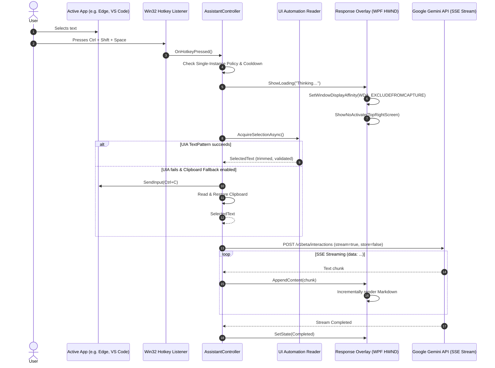

# DOOM — Windows Edition Architecture Specification

## Document Information
- **Product:** DOOM — Windows Edition
- **Version:** 1.0.0
- **Target Platform:** Windows 11 (x64)
- **Framework:** .NET 10 LTS, C# 14, WPF, Win32 Interop, Clean Architecture + MVVM
- **Specification Status:** Architecture Proposal & Migration Design

---

## 1. System Architecture & Dependency Graph

DOOM follows Clean Architecture with inverted dependencies and strict isolation between pure domain logic, native Windows interop, presentation, and the application coordinator.

```
                    ┌────────────────────────┐
                    │        DOOM.App        │
                    │   (Composition Root)   │
                    └───────────┬────────────┘
                                │
          ┌─────────────────────┼─────────────────────┐
          │                     │                     │
          ▼                     ▼                     ▼
┌──────────────────┐  ┌──────────────────┐  ┌──────────────────┐
│ DOOM.Presentation│  │  DOOM.Services   │  │  DOOM.Platform.  │
│  (WPF Views &    │  │  (Orchestration, │  │     Windows      │
│   ViewModels)    │  │   Gemini, Core)  │  │ (Win32, UIA, UAC)│
└─────────┬────────┘  └─────────┬────────┘  └─────────┬────────┘
          │                     │                     │
          └─────────────────────┼─────────────────────┘
                                │
                                ▼
                    ┌────────────────────────┐
                    │       DOOM.Core        │
                    │  (Domain Models, State,│
                    │   Contracts, Errors)   │
                    └────────────────────────┘
```

### Module Responsibilities

1. **`DOOM.Core` (Class Library - Zero external UI/Win32 dependencies)**
   - Domain models: `SelectedText`, `ApiKey`, `ModelId`, `GenerationRequest`, `SourceApplication`, `SelectionLimits`.
   - Contract interfaces: `IAIResponding`, `ICredentialStore`, `IPermissionChecker`, `ISettingsService`, `IGlobalShortcutService`, `ITextAcquisitionService`.
   - State definitions: `PrivacyProtectionState`, `PanelState`, `ShortcutStatus`.
   - Error taxonomy: `GenerationException`, `TextAcquisitionException`, `CredentialStoreException`.
   - Validation & Rules: `SelectionValidator`, `RetryCooldownPolicy`.

2. **`DOOM.Platform.Windows` (Class Library with Windows Desktop / Win32 P/Invoke)**
   - P/Invoke definitions: `User32.dll` (`SetWindowDisplayAffinity`, `RegisterHotKey`, `SendInput`, `GetForegroundWindow`, `SetWindowPos`, `ShowWindow`), `Kernel32.dll`, `Advapi32.dll` (`CredReadW`, `CredWriteW`, `CredDeleteW`).
   - Window Handle & Message Pump Management: Dedicated hidden message-only HWND for receiving `WM_HOTKEY`.
   - UI Automation selection reader (`UiAutomationSelectionReader`) querying `IUIAutomation` and `TextPattern`.
   - Clipboard fallback handler (`ClipboardFallbackHandler`) using Win32 clipboard APIs with sequence tracking and format backup.
   - Monitor and geometry management (`MonitorManager`) for multi-DPI screen placement.

3. **`DOOM.Services` (Class Library)**
   - `GeminiService`: HTTP client handling Interactions API and classic SSE streaming.
   - `GeminiStreamParser`: Parses Server-Sent Events (`data: ` lines) into incremental chunks.
   - `AssistantController`: Single-flight coordinator managing the request lifecycle, cooldown backoff, 15s delay warnings, and cancellation.
   - `SettingsService`: JSON settings persistence in `%APPDATA%\DOOM\settings.json`.
   - `WindowsCredentialStore`: Secure storage via Windows Credential Manager / DPAPI.

4. **`DOOM.Presentation` (WPF User Interface Library)**
   - Views: `ResponseOverlayWindow` (Floating response panel), `SettingsWindow` (Setup, API Key, Privacy toggles), `PrivacyNoticeDialog`.
   - ViewModels: `ResponseOverlayViewModel`, `SettingsViewModel`.
   - Markdown Renderer: High-performance streaming Markdown-to-Inlines parser supporting bold, italics, inline code, links, and lists without full UI rebuilds.
   - Design System: `DoomTheme` XAML styles, colors (`#0B0D10` deep dark), typography, and control templates.

5. **`DOOM.App` (WPF Executable Project)**
   - Entry point: `Program.cs` / `App.xaml.cs`.
   - Composition root: `DependencyInjectionConfiguration`.
   - Win32 Single-Instance Mutex guard (`Global\DOOM_Windows_SingleInstance_Mutex`).
   - System Tray Icon (`SystemTrayCoordinator` / `NotifyIcon`) with dynamic status menu.
   - Clean shutdown and resource disposal.

---

## 2. End-to-End Data Flow



---

## 3. Window Lifecycle & Win32 Interop Design

The Response Overlay is the core user experience. To match the macOS `NSPanel` behavior (`.nonactivatingPanel`, `.floating`, `.canJoinAllSpaces`, `.sharingType = .none`):

### Native Window Styles
- Extended Styles:
  - `WS_EX_NOACTIVATE` (`0x08000000`): Prevents the window from stealing focus from the active text editor when shown.
  - `WS_EX_TOOLWINDOW` (`0x00000080`): Hides the overlay from the Alt+Tab switcher and Windows Taskbar.
  - `WS_EX_TOPMOST` (`0x00000008`): Ensures the floating panel remains above standard application windows.
- Activation Handling:
  - When shown, called with `ShowWindow(hWnd, SW_SHOWNOACTIVATE)`.
  - Mouse clicks inside the window permit interactive scrolling and text copying without forcing the previous application to lose its selection state.

### Window Preservation Policy
- The overlay window is created **once** (lazily upon first invocation).
- The window is **never destroyed or recreated** during stream chunk arrivals or show/hide toggles.
- Hiding the window calls `ShowWindow(hWnd, SW_HIDE)` and preserves in-memory streaming and request tasks.
- Reopening the window calls `ShowWindow(hWnd, SW_SHOWNOACTIVATE)`, displaying the currently active or completed response immediately.

---

## 4. Privacy Mode Specification

### Objective
Exclude the DOOM response overlay from screen capture, screen recording, and video conferencing software (e.g., Zoom, Microsoft Teams, OBS, Discord) while keeping it 100% visible to the local user.

### Native API
```csharp
[DllImport("user32.dll", SetLastError = true)]
public static extern bool SetWindowDisplayAffinity(IntPtr hWnd, uint dwAffinity);

[DllImport("user32.dll", SetLastError = true)]
public static extern bool GetWindowDisplayAffinity(IntPtr hWnd, out uint pdwAffinity);

public const uint WDA_NONE = 0x00000000;
public const uint WDA_EXCLUDEFROMCAPTURE = 0x00000011;
```

### State Machine & Verification
1. **Requested vs Applied:** `PrivacyProtectionState` records `Requested = true` from user settings and queries `GetWindowDisplayAffinity` to record `Applied = true`.
2. **HWND Re-creation Resilience:** In WPF, whenever a window handle is recreated (e.g., monitor DPI switch), the `SourceInitialized` event re-applies `WDA_EXCLUDEFROMCAPTURE`.
3. **Honest User Disclosure:** The UI explicitly discloses that display affinity protection applies to supported software capture engines using the Desktop Window Manager (DWM). It does not protect against external hardware capture devices or physical cameras.

---

## 5. Text Acquisition Design

### Primary Strategy: UI Automation
- Targets `AutomationElement.FocusedElement`.
- Checks for `IsPasswordProperty`: if true, throws `TextAcquisitionException(TextAcquisitionError.PasswordFieldDetected)` and aborts immediately.
- Queries `TextPattern` or `TextPattern2`:
  - Calls `GetSelection()`.
  - Reads text ranges via `GetText(-1)`.
- Enforces character validation via `SelectionValidator`:
  - Min characters: 1
  - Max characters: 20,000
  - Strips NUL (`\0`) and trims whitespace.

### Fallback Strategy: Safe Clipboard Copy (Opt-in)
- Disabled by default.
- Steps:
  1. Record current `GetClipboardSequenceNumber()`.
  2. Backup clipboard objects using `Clipboard.GetDataObject()`.
  3. Synthesize `Ctrl+C` keystrokes via `SendInput`.
  4. Poll `GetClipboardSequenceNumber()` every 20ms with a 600ms timeout.
  5. Read captured text.
  6. Restore previous clipboard object (only if no third-party process updated the sequence number during acquisition).

---

## 6. Gemini Integration Architecture

### Configuration & Security
- Default model: `gemini-3.5-flash` (configurable to `gemini-2.5-flash`).
- System instruction: Preserved verbatim from macOS DOOM specification.
- API Key: Injected strictly in the `x-goog-api-key` header; never logged or serialized.
- Storage: Windows Credential Manager (`CredWriteW`/`CredReadW`) or DPAPI (`ProtectedData`).

### Streaming Implementation
- `GeminiService` opens an HTTP stream using `HttpClient` with `HttpCompletionOption.ResponseHeadersRead`.
- `GeminiStreamParser` reads line-by-line:
  - Filters lines with prefix `data: `.
  - Deserializes JSON payloads.
  - Extracts text increments and yields them asynchronously (`IAsyncEnumerable<string>`).
- Supports cancellation tokens: user hitting `Escape` cancels the `CancellationTokenSource`, immediately aborting HTTP transport without orphaned network tasks.

---

## 7. Testing Strategy

1. **Unit Testing (`DOOM.UnitTests`):**
   - Domain models, limits, and sanitizers (`SelectionValidatorTests`, `RetryCooldownPolicyTests`).
   - Single-flight policy and cancellation (`AssistantControllerTests`).
   - SSE stream parser verification (`GeminiStreamParserTests`).
   - Settings persistence and serialization (`SettingsServiceTests`).
2. **Integration Testing (`DOOM.IntegrationTests`):**
   - Win32 Display Affinity verification with dummy test HWND.
   - Credential store write/read/delete cycles.
   - UI Automation selection retrieval across sample text controls.
3. **Manual Acceptance Verification on Windows 11:**
   - Chrome, Edge, VS Code, Notepad, Adobe Acrobat / Edge PDF reader.
   - Multi-monitor setups with mixed DPI scaling (100%, 150%, 200%).
   - Screen capture verification with OBS Studio and Microsoft Teams.

---
*End of Architecture Specification.*

